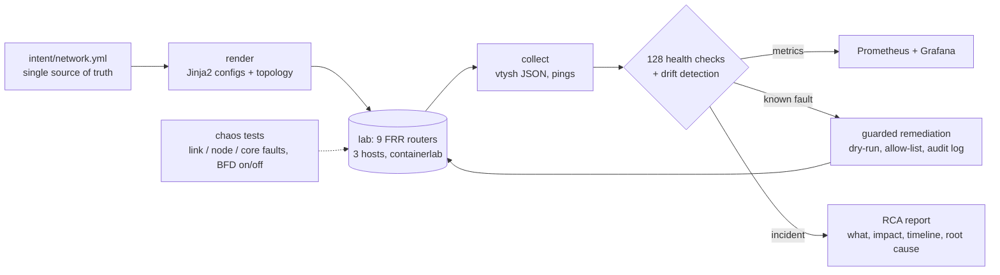
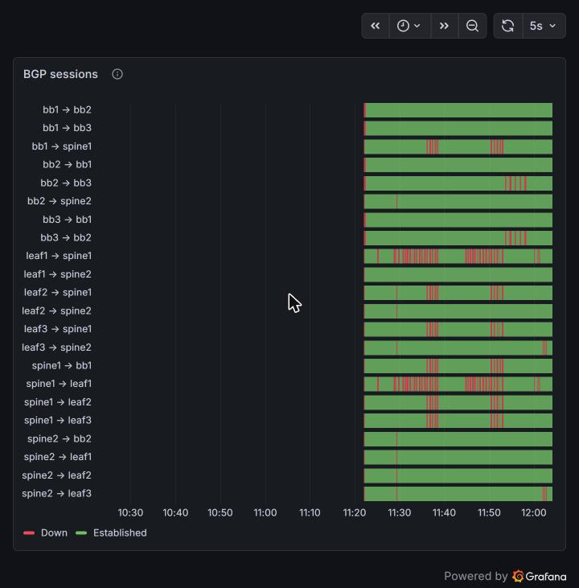
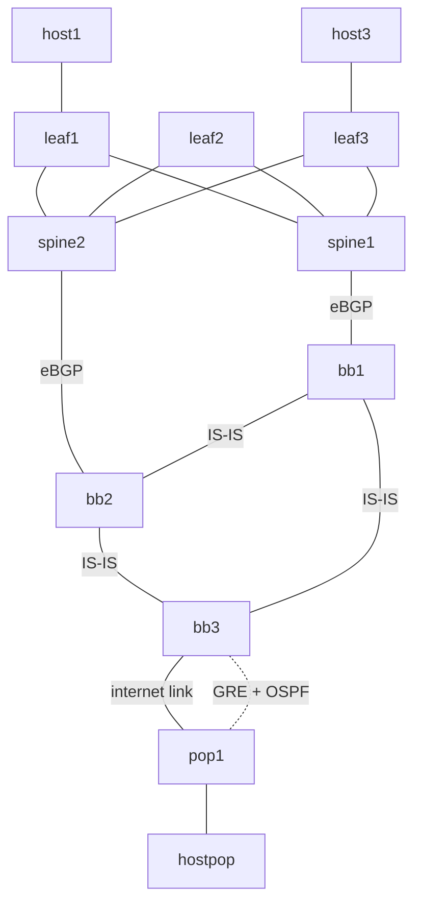

# self-healing-network-lab

[](https://github.com/Newnew-niu/self-healing-network-lab/actions/workflows/ci.yml)


> **A 9-router network that watches itself, breaks on purpose, and fixes itself - with every number
> measured, not assumed.**

I built a small hyperscale-style network (leaf-spine eBGP fabric, IS-IS/iBGP backbone with MPLS,
GRE+OSPF remote POP) in containers with FRRouting, plus **netpulse**, a Python tool that generates the
network's configs from one YAML file, checks its health, detects config drift, repairs known faults
under guard rails, exports metrics to Grafana and writes root-cause reports. Then I injected 50 faults
to measure what actually happens.

### At a glance

| | Result (measured in this lab) |
|---|---|
| Silent "grey" link failures | median outage cut from **6.3-6.8 s to 0.83-0.96 s** (-86-87%) by enabling BFD, across 40 chaos runs |
| Self-healing | **10/10** injected config faults repaired automatically, ~9-13 s to fully healthy, 1 action each |
| Root-cause analysis | correct failed component in **40/40** incidents |
| Health model | **128** checks (BGP, BFD, IS-IS, OSPF, LDP, GRE, interfaces, end-to-end loss/latency), 0 config drift |
| Code quality | **51** tests on real captured router outputs, ruff, CI on every push |

### How it works




*Grafana during the chaos tests: BGP sessions dropping and recovering as faults are injected and removed.*

**Where to look first:** [results](results/chaos/summary.md) ·
[a sample RCA report](reports/20261118T115306-core_blackhole-nobfd.md) · [the intent file](intent/network.yml) ·
[the remediation engine](netpulse/remediate.py) · [what I learned](docs/LEARNING.md)

## Topology



| Part | What runs |
|---|---|
| Fabric | 2 spines (AS 65100) + 3 leaves (AS 65101-65103), eBGP only (RFC 7938), /31 links, ECMP, BFD 300 ms x 3 |
| Backbone | 3 routers in a triangle, AS 65000, IS-IS L2, iBGP between loopbacks, next-hop-self, LDP (MPLS stretch) |
| Remote POP | pop1 reached over an "internet" link; GRE between loopback /32s, OSPF area 0 inside the tunnel |
| Hosts | netshoot containers behind leaf1, leaf3 and pop1 (ping / traceroute / iperf3) |
| Monitoring | netpulse exporter -> Prometheus -> Grafana (provisioned dashboard) |

Full diagram with every IP, ASN and loopback: [docs/topology.md](docs/topology.md).
Pinned versions: FRR 10.6.2, containerlab 0.83.0, Docker 29.10.0, netshoot v0.16, Prometheus v3.15.1,
Grafana 12.4.15, Ubuntu 24.04.5 (kernel 6.8.0-149) in VMware.

## Quick start

On a Linux host with Docker, containerlab and Python 3.11+ (this repo used an Ubuntu 24.04 VM):

```bash
make venv          # .venv + netpulse
make deploy        # render configs from intent/network.yml and start the lab
make check         # 128 health checks against the intent
make drift         # running configs vs intent
make monitor       # exporter on :9101; Grafana on http://<host>:3000 (anonymous viewer)
make remediate     # dry-run plan; make remediate APPLY=1 to really fix
make chaos         # ~30 min: fault injection, BFD on/off, writes results/chaos/
make remediation-trials
make report        # RCA report per chaos run -> reports/
make test lint     # 51 unit tests from saved real FRR outputs, no lab needed
```

## netpulse

| Module | Job |
|---|---|
| `intent.py` | loads + validates `intent/network.yml` (duplicate IPs, RFC 7938 ASN rules, ...), derives neighbours, expected prefixes, IS-IS NETs |
| `render.py` + `templates/` | Jinja2 -> one `frr.conf` per router, the containerlab topology, `prometheus.yml` |
| `collect.py`, `runner.py` | `docker exec ... vtysh -c "show ... json"` in parallel; same calls replayable from fixtures |
| `parsers.py`, `checks.py` | BGP Established + remote AS + expected prefixes, BFD, IS-IS Up, OSPF Full, LDP, GRE (interface *and* ping across), interface admin/oper/errors, end-to-end loss + latency |
| `drift.py` | running-config vs intent, compared as order-independent "context paths" |
| `remediate.py`, `audit.py` | guarded fixes: dry-run default, allow-list, max actions per run, symptom suppression, SHA-256 hash-chained append-only audit log, post-fix verification |
| `exporter.py` + `monitoring/` | `bgp_session_up`, `bgp_prefixes_received`, `isis_adjacency_up`, `ospf_neighbor_full`, `probe_latency_ms`, `probe_loss_ratio`, `config_drift_lines`, ... + Grafana JSON |
| `chaos.py` | link down, link/node/core grey failures (tc netem 100% loss), BFD on/off, 10 ms ping outage measurement, remediation trials |
| `rca.py` | incident report from probes + checks + router logs: what failed, impact, timeline, root cause, fix |
| `ai_summary.py` | optional LLM summary; a validator rejects it if any number, IP or device is not in the source data, and logs every rejection |

## Results (all measured in this lab)

### Convergence: outage per failure, BFD on vs off
5 runs per row, ping every 10 ms (outage = lost packets x 10 ms). Source: [results/chaos/convergence.csv](results/chaos/convergence.csv), [summary.md](results/chaos/summary.md).

| Failure (fault stays in place; traffic must reroute) | BFD off: median (min-max) | BFD on: median (min-max) |
|---|---|---|
| leaf1-spine1 link down (carrier lost) | 100 ms (90-110) | 100 ms (100-100) |
| leaf1-spine1 grey failure (link up, 100% loss both ways) | 6770 ms (5590-8100) | **890 ms** (850-980) |
| spine1 grey failure (100% loss on every egress port) | 6730 ms (6480-7730) | **960 ms** (830-1020) |
| bb2-bb3 backbone grey failure (100% loss both ways) | 6260 ms (5730-8210) | **830 ms** (800-870) |

- For grey failures BFD cut the median outage by **86-87%** (about 7x). For a hard link-down it made no
  difference: both ends lose carrier and tear BGP down immediately.
- Without BFD, recovery came from the BGP hold timer (3 s keepalive / 9 s hold). In the backbone case
  BGP even beat IS-IS, whose adjacency only went down after its 30 s hold time (see the reports).

### Automated detection and remediation
Source: [results/remediation.csv](results/remediation.csv). 5 runs each.

| Injected config fault | Detected (median) | All 128 checks green again (median) | Actions executed per incident |
|---|---|---|---|
| `shutdown` on leaf1 eth1 | 4.2 s | 9.0 s | 1 |
| `neighbor 10.1.2.5 shutdown` on spine2 | 4.0 s | 13.4 s | 1 |

10/10 incidents repaired without a human; the audit log hash chain verified intact. Detection time is
bounded by one collection cycle (~3.5-4 s, mostly the probe pings).

### Root-cause analysis
[reports/index.md](reports/index.md): the RCA named the correct failed component (node vs link, and
which devices) in **40 of 40** chaos incidents, scored afterwards against the fault really injected.
Caveat: 4 single-fault scenario types designed by me; multi-fault incidents are not covered.

### Other measured facts
- Healthy network: 128/128 checks pass, 0 drift lines (`make check`, `make drift`).
- Two injected faults at once (leaf1 eth1 shutdown + spine2 neighbor shutdown) cut host1 off from
  host3 completely (0/5 replies) while each alone would not - captured in `tests/fixtures/faults`.
- GRE tunnel MTU 1476 (1500 - 20 outer IP - 4 GRE); LDP sessions OPERATIONAL between all backbone routers.

### AI summary
Implemented and unit-tested with fake LLM outputs (invented numbers, devices and IPs are rejected and
logged). **Not run against the real API yet**, so there are no AI numbers here.

## What I learned
See [docs/LEARNING.md](docs/LEARNING.md) (concepts, commands, mistakes and fixes per phase),
[docs/CONCEPTS.md](docs/CONCEPTS.md) (concept Q&A) and the honest AI-assistance log
[docs/AI_LOG.md](docs/AI_LOG.md). Highlights:
- A management-network default route (distance 0) silently beat the OSPF default (110) and broke the POP's return path.
- In RFC 7938 fabrics spines never learn each other's loopbacks - my own health check was wrong until I encoded that.
- GRE tunnel endpoints must never be learned through the tunnel (recursive routing); a GRE interface shows UP even when the far end is dead.
- Automation should fix causes, not symptoms, and must be bounded (dry-run, allow-list, max actions, audit).

## Limitations
All containers share one VM, so latencies (~0.1-0.2 ms) are not realistic and there is no real
optics/hardware behaviour; grey failures are simulated with `tc netem`. Lab scale is 9 routers.
