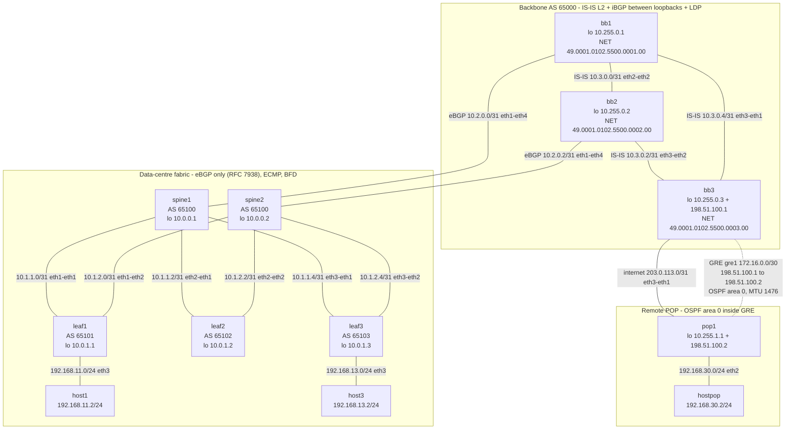

# Topology

Generated from `intent/network.yml` (the source of truth). 9 FRR 10.6.2 routers, 3 Linux test hosts,
Prometheus + Grafana, all in containerlab on one Ubuntu 24.04 VM.

## Address plan

| Range | Use |
|---|---|
| 10.0.0.0/24 | spine loopbacks |
| 10.0.1.0/24 | leaf loopbacks |
| 10.1.1.0/24, 10.1.2.0/24 | leaf-spine /31 links (spine1, spine2) |
| 10.2.0.0/24 | spine-backbone /31 links (eBGP) |
| 10.3.0.0/24 | backbone triangle /31 links (IS-IS) |
| 10.255.0.0/24 | backbone loopbacks (iBGP update-source, LDP transport) |
| 10.255.1.0/24 | POP loopback (advertised in OSPF) |
| 198.51.100.0/24 | GRE tunnel endpoints ("public" /32s on lo, reached by static routes, never in OSPF) |
| 203.0.113.0/31 | "internet" link bb3-pop1 |
| 172.16.0.0/30 | inside the GRE tunnel |
| 192.168.11/13/30.0/24 | host LANs (router .1, host .2) |
| 172.20.20.0/24 | containerlab management network (out of band, not routed) |

## Who runs what

| Device | Protocols |
|---|---|
| leaf1-3 | eBGP to both spines (peer-group FABRIC, BFD), originate loopback + host LAN, `LEAF-OUT` policy: only own prefixes (never transit) |
| spine1-2 | eBGP to all leaves (FABRIC) and to one backbone router (EDGE), BFD |
| bb1, bb2 | eBGP to a spine (EDGE, BFD), IS-IS L2 on the triangle (BFD), iBGP full mesh between loopbacks with next-hop-self, LDP |
| bb3 | IS-IS + iBGP + LDP, GRE to pop1, OSPF on gre1 with `default-information originate`, redistributes the POP prefixes OSPF -> BGP |
| pop1 | OSPF on gre1 (loopback + LAN only), static /32 to the far tunnel endpoint over the internet link |

## Measured healthy path (traceroute)

`host1 -> leaf1 (192.168.11.1) -> spine2 (10.1.2.0) -> bb2 (10.2.0.2) -> bb3 (10.3.0.3) -> pop1 (172.16.0.2, through GRE) -> hostpop`
